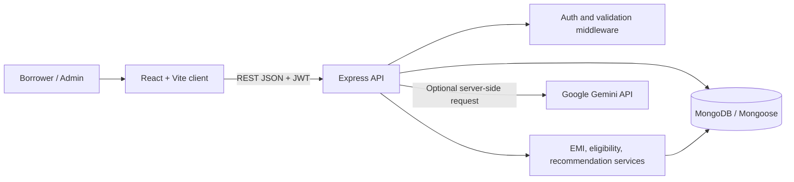
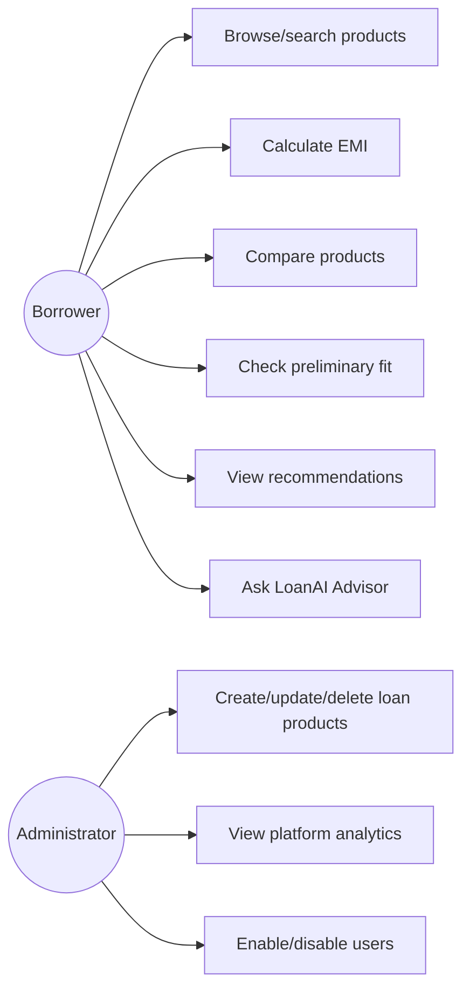
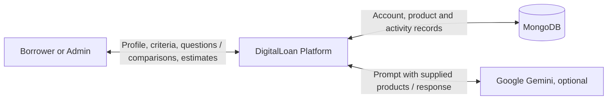
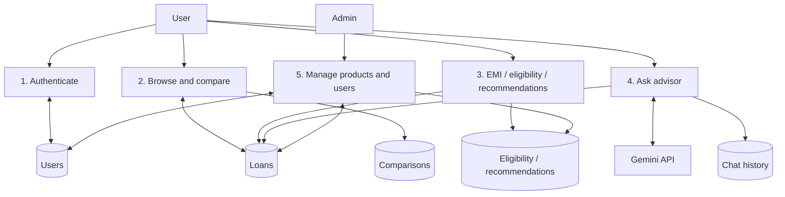
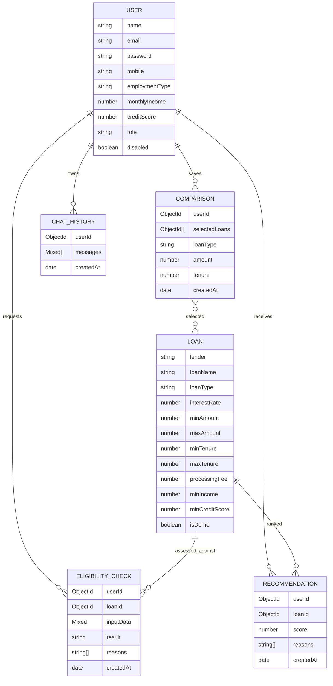

# Digital Loan Comparison System with AI-Powered Recommendations

## 1. Project overview

DigitalLoan is a responsive academic demonstration that brings sample loan product details, estimated EMI calculations, preliminary product fit checks, and explainable recommendations into one web application. It provides a React/Vite client and Node/Express API backed by MongoDB/Mongoose. Gemini is an optional backend-only advisor integration.

**Data notice:** bundled institutions, products, rates, fees, eligibility criteria and product descriptions are fictional illustrative samples. They are not sourced, maintained lender offers. Confirm all terms with a lender. The app is not a lender and cannot approve credit or provide financial advice.

## 2. Problem statement

Loan details can be difficult to compare when rate, fees, amount ranges, tenure and eligibility are presented separately. Users need an understandable view of total repayment and of the factors behind a match, without mistaking estimates for lender decisions.

## 3. Objectives

- Present loan product facts and sample status consistently.
- Calculate EMI, total interest and total repayment using a standard reducing-balance formula.
- Compare two or three selected products side by side.
- Evaluate entered details against explicit product ranges and thresholds.
- Rank products with a visible, explainable scoring model.
- Offer secured accounts, saved comparison history, and a Gemini-backed educational advisor.
- Provide administrative product and usage management endpoints.

## 4. Existing system

Users may need to visit different lender sites and manually combine rates, fees, repayment costs and criteria. This demo models a unified comparison workflow. It does not assert a survey or benchmark of current market offerings.

## 5. Proposed system

An authenticated user can enter a financial profile, search and sort products, calculate an EMI, save a comparison, run an estimated eligibility check, and see recommendation reasons. Admins manage products and view aggregate activity. Every result is informational and uses demo sample data unless an administrator later configures verified data.

## 6. Functional requirements

1. Register and sign in; securely hash passwords and issue JWTs.
2. Browse, search, filter by loan type and sort active products.
3. Inspect product ranges, example EMI and documents.
4. Calculate EMI interactively and show principal/interest split.
5. Compare two or three products for an entered amount and tenure.
6. Assess entered age, income, credit score, amount and tenure against displayed criteria; explain failed criteria.
7. Rank products using a transparent score and human-readable reasons.
8. Ask LoanAI educational questions using user profile and a bounded product-data context.
9. Restrict product mutation, platform analytics, and account management to admins.
10. View recent comparisons and dashboard recommendations.

## 7. Non-functional requirements

- Responsive layouts for phone, tablet and desktop; keyboard-usable forms and controls.
- REST JSON API with input validation, bounded request sizes, generic client errors and server-side logs.
- JWT-based authentication; bcrypt hashing; Helmet headers, CORS allowlist and API rate limits.
- Configuration and credentials supplied through environment variables.
- Clear empty, loading and error states; no frontend API secrets.
- Calculations and recommendation factors should be deterministic and inspectable.

## 8. System architecture

## 9. Use case diagram

## 10. DFD level 0

## 11. DFD level 1

## 12. ER diagram

## 13. Database schema

- **User:** name, unique lowercase email, bcrypt password (excluded by default), mobile, employment type, monthly income, optional credit score, role, disabled flag, timestamps.
- **Loan:** lender/product name, enumerated type, annual interest rate, amount and month ranges, fee percentage, minimum income/score, criteria, document list, active status, `isDemo`, last-updated date, timestamps.
- **Comparison:** user reference, selected loan references, search type, amount, tenure, timestamps.
- **EligibilityCheck:** user and product references, captured input, result enum-like string and reason list, timestamps.
- **Recommendation:** user/product references, score and reasons, timestamps.
- **ChatHistory:** user reference and ordered role/content messages, timestamps.

## 14. API documentation

Base URL: `http://localhost:5000/api`. Protected routes require `Authorization: Bearer <JWT>`.

| Method | Route | Access | Purpose |
|---|---|---|---|
| POST | `/auth/register` | Public | Register and return token/profile |
| POST | `/auth/login` | Public | Authenticate and return token/profile |
| GET | `/auth/profile` | User | Current profile |
| PUT | `/auth/profile` | User | Update employment type, income and credit score |
| GET | `/loans` | Public | Search/filter/sort/paginate products (`type`, `q`, `sort`, `order`, `page`, `limit`) |
| GET | `/loans/stats` | Public | Product and lender counts |
| GET | `/loans/:id` | Public | Product details |
| POST | `/loans/compare` | User | Save and calculate comparison; `loanIds` (2–3), `amount`, `tenure` |
| GET | `/loans/history` | User | Recent comparisons |
| GET | `/loans/recommendations` | User | Profile-based ranked products |
| POST | `/recommendations` | User | Save ranked products for type/amount/tenure |
| POST | `/emi/calculate` | Public | Calculate EMI, interest and total repayment |
| POST | `/eligibility/check` | User | Check selected type against sample criteria |
| POST | `/ai/chat` | User | Gemini-powered answer from bounded context |
| POST | `/loans` | Admin | Create product |
| PUT | `/loans/:id` | Admin | Update product |
| DELETE | `/loans/:id` | Admin | Remove product |
| GET | `/admin/overview` | Admin | Aggregate product and usage metrics |
| GET | `/admin/users` | Admin | View accounts |
| PATCH | `/admin/users/:id/status` | Admin | Enable/disable account |

Validation errors return HTTP 400 with `{ "message": "..." }`; authentication failures 401, authorization failures 403, missing resources 404, and unexpected server failures use a generic 500 message. Details are logged server-side.

## 15. Technology stack

React 18, Vite, JavaScript, React Router, Axios, Chart.js/react-chartjs-2, Lucide icons, custom responsive CSS; Node.js, Express, express-validator, JWT, bcryptjs, Helmet, CORS, express-rate-limit; MongoDB and Mongoose; optional Google Gemini Generative AI SDK.

## 16. Security features

- bcryptjs password hashes (12 salt rounds); never return password fields.
- JWT signing secret and Gemini key only in backend environment.
- Role middleware for admin routes; disabled-account rejection.
- express-validator rules for identity, comparison, calculator and eligibility inputs.
- Helmet headers, configured origin allowlist, JSON payload size cap and rate limiting.
- Mongoose model schemas/enums and generic API error responses.
- Recommendation and Gemini output must not be treated as credit approval; product facts are limited to stored loan context.

## 17. AI recommendation architecture

Rule-based ranking is deterministic and separately explainable: amount match 30 points; tenure match 15; income threshold 20; score compatibility 15; EMI at or below 35% of stated monthly income 15; fee at or below 1% 5. Points are capped at 100. Reasons are shown per product. Missing credit score is not treated as a verified match and is called out. Eligibility separately returns `potentially_eligible` or `not_eligible` according to explicit range and threshold checks; it does not promise lender approval. Gemini receives only the authenticated user's basic profile and a limited list of product facts. The server instructs it not to invent rates, eligibility rules or decisions. Missing API configuration produces HTTP 503.

## 18. Testing strategy

Suggested verification before a project demonstration: unit-check zero/positive-rate EMI math, eligibility boundary conditions, and recommendation points; API integration-check registration/login/profile/admin guards/product CRUD/comparison/eligibility; run the frontend production build; test narrow/mobile layouts and keyboard operation; exercise Gemini configured/unconfigured paths; verify MongoDB indexes and seed reproducibility; inspect built assets for secrets. The provided seed command resets the loan collection to illustrative products.

## 19. Future scope

- Replace sample data with verified lender-sourced records, sources, consent, freshness timestamps and scheduled validation.
- Add pagination controls, server-side filtering and audit trails for admin changes.
- Add opt-in profile editing and configurable affordability assumptions.
- Add downloadable comparison summaries and localized accessibility improvements.
- Add automated unit/integration suites, observability and deployment configuration.
- Evaluate recommendation calibration and AI responses with privacy-preserving review.

## 20. Conclusion

DigitalLoan demonstrates a modular comparison workflow that makes assumptions and matching factors visible. Its main project outcome is an extensible architecture combining user accounts, product data, transparent financial calculations, preliminary checks, explainable ranking and an optional bounded AI advisor. It remains an educational prototype until verified product feeds, production security review, and operational controls are added.
